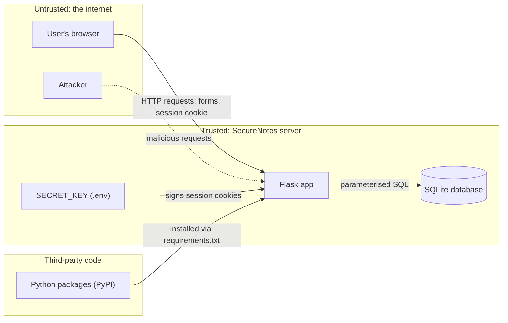

# SecureNotes Threat Model (STRIDE)

**Version:** 1.2 (24 October 2026). v1.0 was written before any feature code
**Method:** [STRIDE](https://learn.microsoft.com/en-us/azure/security/develop/threat-modeling-tool-threats): Spoofing, Tampering, Repudiation, Information disclosure, Denial of service, Elevation of privilege

This document answers four questions:

1. What are we building?
2. What can go wrong?
3. What are we going to do about it?
4. How will we check it worked?

---

## 1. What are we building?

SecureNotes is a web app where users register, log in, write private notes, and share individual notes **read-only** with other users.

### System diagram

### Trust boundaries

A trust boundary is where data crosses from something we don't control into something we do. Every input crossing a boundary must be checked.

| # | Boundary | Why it matters |
|---|---|---|
| TB1 | **Browser → Flask app** | Everything from the browser (form fields, URLs, cookies) can be forged by an attacker. This is where most attacks arrive. |
| TB2 | **Flask app → database** | User input must never be able to change the *meaning* of a SQL query. |
| TB3 | **Packages → Flask app** | We run code written by other people, so it needs to be checked for known vulnerabilities. |

### Assets (what we are protecting)

| Asset | Why it is valuable |
|---|---|
| **Note contents** | Can contain passwords, addresses and important dates. Even ordinary notes can reveal where someone will be and when (see attacker A3). |
| **User passwords** | People reuse passwords, so a leak can compromise their other accounts too. |
| **Session cookies** | Whoever holds a valid session cookie *is* that user, as far as the app knows. |
| **Sharing permissions** | Decide who can read which note. If these are wrong, private notes leak. |
| **`SECRET_KEY`** | Signs session cookies. If it leaks, anyone can forge a session for any user. |
| **Availability** | Users need to be able to reach their notes. |

---

## 2. What can go wrong? Attackers

| # | Attacker | Goal |
|---|---|---|
| A1 | **Account thief** | Take over a user's account by guessing or reusing their password, or stealing their session cookie |
| A2 | **Snoop** | Read other people's private notes, e.g. by changing the note ID in the URL |
| A3 | **Stalker** | Target *one specific person* to learn where they will be and when. Patient, motivated and personal. The harm can be physical, not just digital. |
| A4 | **Credential-stuffing bot** | Automatically try leaked username/password pairs from other breaches |
| A5 | **Malicious user of the app** | Attack *other* users, e.g. by hiding a script in a shared note |
| A6 | **Malicious website** | Trick a logged-in user's browser into performing actions in SecureNotes |
| A7 | **Database attacker** | Dump all data at once through SQL injection or by stealing the database file |
| A8 | **Supply-chain risk** | Get in through a vulnerable or compromised third-party package |
| A9 | **Denier** | Do something harmful, then deny it ("I never shared that note") |
| A10 | **Disrupter** | Make the app unusable for everyone else |

**Key insight:** the most dangerous data in a notes app isn't always the obvious kind. A note saying *"Birthday party, 12 Main St, Saturday 7pm"* is harmless to most attackers but dangerous in the hands of a stalker (A3). So **access control on every single note** is the most important defence in this app.

---

## 3. What are we going to do about it? STRIDE analysis

**Status key:** ⬜ Planned · ✅ Implemented · 🔍 Verified (tested or pentested)

### S: Spoofing (pretending to be someone else)

| ID | Threat | Attacker | Defence | Status |
|---|---|---|---|---|
| S1 | Attacker guesses or reuses a user's password | A1, A3, A4 | Minimum password length; **rate limiting** on login | ⬜ |
| S2 | Attacker steals a session cookie | A1, A5 | Cookie flags `HttpOnly` (JavaScript can't read it), `SameSite=Lax`, and `Secure` in production (sent over HTTPS only) | 🔍 |
| S3 | Attacker forges a session cookie | A1 | Cookies are signed with a strong random `SECRET_KEY` kept out of Git; the app refuses to start without one | 🔍 |
| S4 | Attacker plants a session ID before the victim logs in (session fixation) | A1 | Clear the session completely on login and logout | ✅ |
| S5 | Attacker discovers which usernames have accounts (user enumeration) | A3, A4 | The same generic "Invalid username or password" message whether the username exists or not. **Accepted risk:** registration must say "username taken", which also reveals that the account exists; rate limiting will slow down anyone checking usernames in bulk. Login also checks a dummy hash for unknown usernames, so response *time* doesn't reveal them either. | 🔍 (login) |

### T: Tampering (changing data without permission)

| ID | Threat | Attacker | Defence | Status |
|---|---|---|---|---|
| T1 | User edits or deletes a note they don't own | A2, A5 | **Owner check** on every edit and delete; shared users are read-only | 🔍 |
| T2 | Malicious site submits forms as the logged-in user (CSRF) | A6 | **CSRF token** on every form (Flask-WTF `CSRFProtect`, applied app-wide); `SameSite=Lax` cookies; logout is POST-only | 🔍 |
| T3 | Input changes the meaning of a SQL query (SQL injection) | A7 | **Parameterised queries only**, never string concatenation | ✅ (all queries) |
| T4 | Vulnerable or compromised package changes app behaviour | A8 | **Pinned versions**; **pip-audit** in CI checks for known vulnerabilities; CI actions pinned to commit hashes | 🔍 |

### R: Repudiation (denying an action)

| ID | Threat | Attacker | Defence | Status |
|---|---|---|---|---|
| R1 | User denies sharing a note or logging in | A9 | **Security event log** recording logins (successful and failed), shares, unshares and deletions, with user ID and timestamp. Note contents and passwords are **never** logged. | ⬜ |

### I: Information disclosure (data leaking)

| ID | Threat | Attacker | Defence | Status |
|---|---|---|---|---|
| I1 | User reads a note by changing its ID in the URL (**IDOR**) | A2, A3 | Every note lookup checks *"is this user the owner, or has the note been shared with them?"* (`get_readable_note()`, used for viewing only) | 🔍 |
| I2 | App reveals that a note exists even when access is denied | A2, A3 | Return **404 Not Found** (not 403 Forbidden) for notes the user can't access, so attackers can't tell "exists but forbidden" from "doesn't exist" | 🔍 |
| I3 | Script hidden in a shared note runs in the victim's browser (**XSS**) | A5 | Jinja2 **auto-escaping**; **Content-Security-Policy** header as a second layer: no scripts may run at all | 🔍 |
| I4 | Passwords leak if the database is stolen | A7 | Store **argon2id hashes** only, never the passwords themselves | 🔍 |
| I5 | Error pages reveal code, paths or settings | All | Debug mode off outside local development; generic error pages | 🔍 (debug off; error pages later) |
| I6 | `SECRET_KEY` or the database is committed to the public repo | All | `.gitignore` excludes `.env`, `instance/` and database files | ✅ |
| I7 | App is loaded in a hidden frame on another site to trick clicks (clickjacking) | A6 | `X-Frame-Options: DENY` / CSP `frame-ancestors 'none'` | 🔍 |
| I8 | On a shared computer, the next person presses Back after logout and sees the previous user's notes from the browser cache | A3 | `Cache-Control: no-store` on every page except static files | 🔍 |

### D: Denial of service (making the app unusable)

| ID | Threat | Attacker | Defence | Status |
|---|---|---|---|---|
| D1 | Flood of login attempts | A4, A10 | **Rate limiting** on login (shared with S1) | ⬜ |
| D2 | Huge notes or form submissions fill memory or disk | A10 | Maximum note length (title 100, body 10,000 characters); Flask `MAX_CONTENT_LENGTH` rejects requests over 256 KB | 🔍 |

### E: Elevation of privilege (gaining more access than allowed)

| ID | Threat | Attacker | Defence | Status |
|---|---|---|---|---|
| E1 | User with read-only access to a shared note edits it or re-shares it | A5 | Edit, delete, share and revoke all go through `get_owned_note()`, which checks for **owner**, not just "can read" | 🔍 |
| E2 | Logged-out user reaches pages that need a login | All | A `login_required` check on every page except register, login and home | 🔍 |

---

## 4. How will we check it worked?

Every defence above will be checked in at least one of these ways:

- **Automated tests (pytest):** e.g. user B requests user A's note and must get a 404; a form posted without a CSRF token must be rejected.
- **CI pipeline (GitHub Actions):** tests, **Bandit** (scans our code for insecure patterns) and **pip-audit** (scans dependencies) run on every push.
- **Self-pentest:** attack the finished app with **Burp Suite** (intercept and modify requests, e.g. change note IDs, remove CSRF tokens, replay sessions) and **ffuf** (discover hidden pages). Findings will be written up in `docs/pentest-report.md`.

As defences are built and tested, the status columns above will be updated. Tests live in [`tests/`](../tests/); `tests/test_notes.py` holds the access-control (IDOR) tests.

---

## Assumptions and out of scope

- **Usernames, not emails.** The app never sends email, so it doesn't collect email addresses. Storing less personal data means a database leak reveals less about real people (data minimisation, relevant to A3 and A7).
- **No password reset by email.** This is a deliberate choice: password reset flows are a common source of account takeovers, and leaving the feature out removes that risk. The trade-off is that a user who forgets their password loses access.
- **No admin role.** With no admin accounts, there are no admin privileges for an attacker to gain.
- **HTTPS** is assumed in any real deployment. Locally, the app runs over plain HTTP on `127.0.0.1` only.
- **Compromised user devices** (malware, someone using an unlocked laptop) are out of scope: the app can't defend against an attacker who already controls the user's computer.
- **Weak but long passwords:** the app enforces a minimum length but doesn't check passwords against breach lists in v1.

## Revision history

| Version | Date | Change |
|---|---|---|
| 1.0 | 18 Oct 2026 | First version, written before feature code |
| 1.1 | 19 Oct 2026 | Switched accounts from email to username (data minimisation); updated A4 and S5 |
| 1.2 | 24 Oct 2026 | Added I8 (browser caching of private pages), found while adding security headers |
